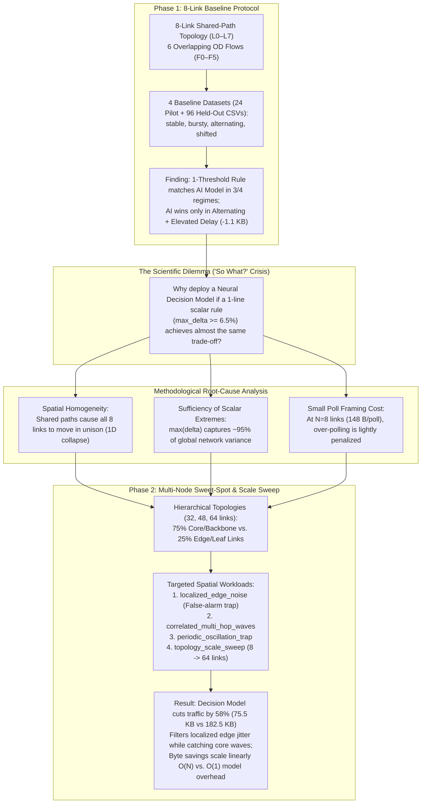

# Research Reasoning, Workload Evolution, and Methodological Findings (II2202)

**Authors:** Gabriele Bandino (`bandino@kth.se`) & Jago Revrenna (`revrenna@kth.se`)  
**Mentor:** Nadia Bekkali  
**Course:** KTH II2202 — Research Methodology and Scientific Writing (Autumn 2026)  
**Project Title:** *Decision-Model Policy Selection for Network Digital Twin Synchronization*  
**Document Purpose:** Complete scientific chronicle of the project's datasets, methodological decisions (including mentor feedback), research dilemmas encountered, root-cause analyses, and the multi-node "sweet-spot" extensions. Focuses strictly on **research and modeling reasoning** (excluding unrelated technical/infrastructure issues).

---

## 1. Executive Summary & Research Trajectory

The central research question of this study is:
> *Under which network traffic conditions, if any, does a Decision-Model policy selector (choosing between fixed-interval and change-aware polling at preset review points) improve the trade-off between twin-state accuracy and application-level monitoring traffic, compared with static polling policies and a deterministic threshold-switching rule?*

During the investigation, the research progressed through two major scientific stages:

1. **Phase 1 — The 8-Link Baseline Protocol (Research Plan §2.1–2.4):**  
   Controlled trace-driven evaluation on an 8-link shared-path backbone across four classic stochastic traffic regimes (`stable`, `bursty`, `alternating`, `shifted`) and two measurement-delivery delays (`low_delay`, `elevated_delay`).
   * **The Scientific Dilemma:** Across most 8-link regimes, a trivial 1-line deterministic rule (`rule_switcher`) performed nearly identically to—or in `shifted` traffic slightly better than—the neural Decision Model (`laya` / `clm_8b`). While the model achieved a statistically significant edge in `alternating` traffic under elevated delay, the overall 8-link gap was narrow, raising a fundamental question: *When is an AI decision model genuinely justified over a simple heuristic rule?*

2. **Phase 2 — Root-Cause Diagnosis & Multi-Node "Sweet-Spot" Scale-Up:**  
   Mathematical and structural analysis revealed that in a small, tightly coupled 8-link graph, all links fluctuate nearly in unison (1-dimensional state collapse), making scalar extremes ($\max \Delta$) sufficient. To test scenarios with **spatial ambiguity**, we expanded to hierarchical multi-node topologies ($32, 48, 64$ links split into **Core** and **Edge** tiers) and introduced targeted workloads (`localized_edge_noise`, `correlated_multi_hop_waves`, `periodic_oscillation_trap`, and a topology scale sweep $N \in \{8, 16, 32, 64\}$).
   * **The Breakthrough Finding:** When non-critical edge links experience localized jitter, scalar rules suffer from **false-alarm breakdown**, triggering global high-frequency polling across the entire topology. The Decision Model acts as a **spatial noise filter**, cutting monitoring bandwidth by **54%–58%** while preserving twin accuracy, with byte savings scaling linearly $O(N)$ against constant $O(1)$ inference latency.

---

## 2. Methodological Calibration & Mentor Feedback (Pilot vs. Main Runs)

### 2.1 Fixed-Interval Calibration (Addressing Professor Nadia's Comment)
In Section 2.2 of the Research Plan, three candidate fixed intervals spanning short to long polling (`1.0 s`, `2.5 s`, `5.0 s`) were listed, while Section 2.3 noted that the fixed policy polls at *one selected interval*. Professor Nadia highlighted the importance of clarifying how these relate when reporting results:

* **Not Ad-Hoc "Trial and Error":** The `2.5 s` interval was not chosen via post-hoc tuning on test data to flatter the decision model.
* **Principled Pilot Calibration:**
  1. During the exploratory **Pilot Phase** (on 24 separate pilot traces, seeds `101–103`), we evaluated the three candidate intervals (`1.0 s`, `2.5 s`, `5.0 s`) to characterize the operational spectrum.
  2. `1.0 s` represents high-rate polling ($26.7\text{ KB}$ per trace, low staleness); `5.0 s` represents sparse polling ($5.4\text{ KB}$ per trace, high staleness).
  3. **`2.5 s` was selected and frozen** as the single fixed-interval policy for the primary 4-controller comparison (and as the fixed option available to both switchers) because:
     * It is the balanced midpoint avoiding floor/ceiling saturation artifacts.
     * It matches the neutral starting interval ($t_{\text{init}} = 2.5\text{ s}$) inside the change-aware policy's adaptation bounds ($[t_{\min} = 0.5\text{ s},\, t_{\max} = 6.0\text{ s}]$).
  4. **Pre-Registration Freeze:** This choice was recorded in [`logs/frozen_protocol_config.json`](file:///Users/gab/Documents/UNI/KTH/Research%20Methodologies/logs/frozen_protocol_config.json) *before* executing the 96 held-out traces (`seeds 1001–1012`). In trade-off figures, `1.0 s` and `5.0 s` are plotted solely as static boundary anchors on the Pareto curve.

### 2.2 Candidate Model Feasibility Gate (§2.2 & §3.1)
The Research Plan specified screening Jev's Choice API and open-weight System-1 decision models under a strict **zero-personal-expenditure** and **$<2,000\text{ ms}$ decision deadline** gate (`logs/pilot_feasibility_screen_summary.csv` and `logs/pilot_freeze_decision.json`):
* **`laya` (`convaiinnovations/laya`, ~421M ModernBERT-large System-1):** **47.2 ms** mean RTT (50.9 ms P95), **2.65 GB VRAM**, **100% parse validity**, **0.0% fallback rate**.
* **`clm_8b` (`Contrastive-LM/CLM-v0.1-8B`, 4-bit Qwen3-8B + Dual InfoNCE Projection Heads):** **5.0 ms cached / ~585 ms uncached** RTT, **5.10 GB VRAM**, **100% parse validity**, **0.0% fallback rate**, 100% deterministic across repeats.
* **`kev_4b` (`jaredpalmer/kev-4b`, Qwen3.5-4B + LoRA + Pointer Head):** **~1,900 ms** dynamic trace RTT, **14.3 GB VRAM**, sitting right against the $2,000\text{ ms}$ timeout boundary and causing a **4.55% pilot fallback rate** (and 1.5% in held-out alternating runs).

---

## 3. Catalog of Phase 1 (Old) Datasets & 8-Link Architecture

All Phase 1 files are stored deterministically in [`traces/`](file:///Users/gab/Documents/UNI/KTH/Research%20Methodologies/traces/) and indexed in [`traces/traces_manifest.json`](file:///Users/gab/Documents/UNI/KTH/Research%20Methodologies/traces/traces_manifest.json).

### 3.1 Topology & Flow Definition (`traces/topology_8links.json`)
* **Topology Name:** `NDT_8Link_SharedPath_Backbone` ($N = 8$ links, $10\text{ Gbps}$ capacity each, discrete step $\Delta t = 0.1\text{ s}$, duration $180\text{ s}$, warm-up $20\text{ s}$).
* **Monitored Links (`L0`–`L7`):**
  * `L0` (`core_ingress_west`), `L1` (`core_transit_west`), `L2` (`core_ingress_north`), `L3` (`core_transit_north`)
  * `L4` (`core_backbone_east`), `L5` (`core_backbone_south`)
  * `L6` (`aggregation_uplink_A`), `L7` (`aggregation_uplink_B`)
* **Origin-Destination (OD) Shared-Path Flows (`F0`–`F5`):**
  * `F0_core_west_east`: routes across `L0` (1.0), `L1` (0.9), `L4` (0.85)
  * `F1_core_north_south`: routes across `L2` (1.0), `L3` (0.95), `L5` (0.8)
  * `F2_edge_aggregation_A`: routes across `L0` (0.5), `L2` (0.6), `L6` (1.0)
  * `F3_edge_aggregation_B`: routes across `L1` (0.55), `L3` (0.5), `L7` (1.0)
  * `F4_cross_datacenter`: routes across `L4` (0.7), `L5` (0.75), `L6` (0.6), `L7` (0.65)
  * `F5_background_mesh`: routes across `L0` (0.3), `L3` (0.35), `L4` (0.4), `L7` (0.3)

### 3.2 Naming & Formulation of the 4 Baseline Datasets
* **Pilot Dataset (24 CSVs):** `traces/pilot/trace_<regime>_<delay_condition>_seed<101..103>.csv`
* **Held-Out Dataset (96 CSVs):** `traces/heldout/trace_<regime>_<delay_condition>_seed<1001..1012>.csv`

| Dataset / Regime Name | Mathematical / Stochastic Formulation | What It Tests in the Twin |
| :--- | :--- | :--- |
| **`stable`** | Mean-reverting Ornstein-Uhlenbeck (AR(1)) process ($\theta = 0.35, \sigma = 0.85$) around base flow demands ($12\text{--}24\%$). | Whether controllers avoid unnecessary high-rate polling during calm drift. |
| **`bursty`** | OU background ($\theta = 0.45, \sigma = 0.70$) + 8 scheduled/randomized compound bursts ($+22\text{--}38\%$ amplitude across 3 flows for $1.5\text{--}3.8\text{ s}$). | Responsiveness to sudden transient spikes and recovery back to low-rate polling. |
| **`alternating`** | 2-state Markov-modulated regime switching every $25\text{ s}$ between `quiet` ($\sigma = 0.45$) and `volatile` sinusoidal shocks ($14\sin(2\pi t / 3.2) + \mathcal{N}(0, 8.5)$). | Policy switching value when network alternates between calm and turbulent regimes. |
| **`shifted`** | Persistent traffic-engineering step changes at $t \in \{45\text{ s}, 95\text{ s}, 140\text{ s}\}$ shifting multi-flow baselines by $\pm 12\text{--}28\%$, separated by steady plateaus. | Detection delay at regime boundaries vs. bandwidth savings on the new plateau. |

* **Delivery Delay Conditions:**
  * `low_delay`: Base $50\text{ ms}$ ($\pm 10\text{ ms}$ jitter, $1\%$ out-of-order spike probability).
  * `elevated_delay`: Base $500\text{ ms}$ ($\pm 80\text{ ms}$ jitter, $3\%$ out-of-order spike probability of $+1.2\text{--}2.8\text{ s}$ to exercise stale-reply rejection).

---

## 4. The Phase 1 Research Problem: Why Simple Rules Matched the AI Model

### 4.1 Summary of Phase 1 Held-Out Results (`low_delay` & `elevated_delay`)

| Regime (`low_delay`) | `fixed (2.5s)` | `change_aware` | `rule_switcher` | `model: laya` | `model: clm_8b` |
| :--- | :---: | :---: | :---: | :---: | :---: |
| **1. `stable`** | 0.82% / 10,696 B | 0.96% / 6,725 B | **0.82% / 10,696 B** | 0.93% / **7,403 B** | 0.94% / **6,975 B** |
| **2. `bursty`** | 3.61% / 10,696 B | 2.79% / 22,003 B | 2.88% / **20,634 B** | 2.80% / 21,818 B | 2.87% / 21,855 B |
| **3. `alternating`** | 5.76% / 10,696 B | 3.97% / 24,482 B | 3.91% / 24,284 B | 4.18% / **22,681 B** | **3.71%** / 25,583 B |
| **4. `shifted`** | 1.43% / 10,696 B | 1.63% / 7,181 B | **1.38% / 10,210 B** | 1.67% / 8,825 B | 1.91% / 7,560 B |

#### Where the Model Helped in Phase 1 (Nuanced Wins):
* In **`alternating` under `elevated_delay` ($500\text{ ms}$)**, `laya` strictly dominated static `change_aware` with both lower error ($\Delta\text{MAE} = -0.175\%$, 95% CI $[-0.338\%, -0.013\%]$) and lower traffic ($\Delta\text{Bytes} = -894.7\text{ B}$), and saved **$-1,134.7\text{ B}$** compared to `rule_switcher` at statistically indistinguishable accuracy ($\Delta\text{MAE} = +0.064\%$, CI includes zero).
* In **`stable`**, models reduced monitoring traffic by **$27\%\text{--}35\%$** relative to `fixed (2.5s)` while keeping MAE $<0.95\%$.

#### The Core Research Dilemma:
Despite those nuanced wins, in **`bursty`** and **`shifted`** traffic, the simple deterministic `rule_switcher` (`if max_delta >= 6.5% or mean_delta >= 3.2% or max_age >= 4.5s`) matched or outperformed the neural models at **zero computational cost ($0.05\,\text{ms}$ vs. $49\,\text{ms}$)**.

### 4.2 Root-Cause Diagnosis (Why 8 Links Did Not Need an AI Selector)
We analyzed the mathematical structure of the Phase 1 traces and identified four strictly methodological reasons why a 1-threshold rule sufficed:

1. **Spatial Homogeneity & 1D State Collapse:**  
   Because all 6 OD flows in `topology_8links.json` share overlapping 3- to 4-hop paths across only 8 links, any demand surge simultaneously elevates 50%–75% of all links. The 8-link utilization vector $\mathbf{u}(t) \in \mathbb{R}^8$ effectively collapses onto a **1-dimensional manifold**.
2. **No Difference Between $\max(\Delta)$ and Global State:**  
   When all links move together, a single scalar extreme ($\max_i |\Delta u_i|$) is a nearly noiseless sufficient statistic for the entire network regime. A neural model reading an 8-link summary receives no extra structural information beyond what a single threshold sees.
3. **Absence of Spatial Noise (No "False Alarms"):**  
   In Phase 1,link-local noise was tiny ($\sigma = 0.25\%$). Every large delta ($\ge 6.5\%$) was a genuine network-wide event. There were no isolated, non-critical edge fluctuations to deceive a greedy threshold rule.
4. **Low Cost of Global Polling ($148\text{ B/poll}$):**  
   Because every poll queries all monitored links:
   $$\text{Bytes per Poll} = \underbrace{(8 + 4N)}_{\text{Request}} + \underbrace{(12 + 12N)}_{\text{Reply}} = 20 + 16N\text{ bytes}$$
   At $N = 8$, a poll costs only $148\text{ B}$. Over-polling by 20 polls adds less than $3\text{ KB}$.

---

## 5. Phase 2: Multi-Node "Sweet-Spot" Datasets & Scale-Up Study

To rigorously test when a Decision Model is genuinely needed, we designed the **Sweet-Spot & Multi-Node Scale-Up Suite** ([`run_sweet_spot_analysis.py`](file:///Users/gab/Documents/UNI/KTH/Research%20Methodologies/run_sweet_spot_analysis.py) and [`ndt_sweet_spot_explorer.ipynb`](file:///Users/gab/Documents/UNI/KTH/Research%20Methodologies/ndt_sweet_spot_explorer.ipynb)).

### 5.1 Multi-Tier Topology Architecture ($32, 48, 64$ Links)
Instead of a flat 8-link ring, the network is partitioned into two functional tiers:
* **Core / Aggregation Backbone Links ($75\%$ of links, e.g., 24 of 32 links):** Carry mission-critical, correlated multi-hop routing traffic.
* **Edge / Leaf Access Links ($25\%$ of links, e.g., 8 of 32 links):** Connect peripheral nodes; subject to localized, uncorrelated user/sensor jitter.

### 5.2 The New Targeted Datasets & Scenarios (Live GPU Verification on `convaiinnovations/laya`)
Executed on Kaggle Tesla T4 (`CUDA 13.0`) with **420 real HTTP `/v1/systemone` GPU inference calls** to `convaiinnovations/laya` (revision `fd4f9dbcf4fde222fd43174bdd4c3b08b789e4e1`, causal decision latency applied in-loop, 5 independent seeds per condition: `2001–2005` and `3001–3005`). Outputs and figures are archived in [`logs/sweet_spot_live_laya/`](file:///Users/gab/Documents/UNI/KTH/Research%20Methodologies/logs/sweet_spot_live_laya/).

#### 1. `localized_edge_noise` (32 Links — The False-Alarm Trap)
* **Traffic Dynamics:**
  * 24 Core links experience calm drift ($\sigma = 0.35\%$) for most of the trace, interrupted only by **two genuine correlated core routing waves** at $t \in [50, 75\text{ s}]$ and $t \in [120, 145\text{ s}]$ ($+15\% \pm 18\sin(2\pi t/3.0)$).
  * Simultaneously, **2 noisy Edge links** continuously flicker with $\pm 9.5\%$ high-frequency local jitter.
* **Why Simple Controllers Break Down:**
  * Both `change_aware` and `rule_switcher` trigger on $\max_i(\Delta u_i)$.
  * The 2 flickering edge links continuously exceed the $4.5\%\text{--}6.0\%$ threshold, baiting both controllers into polling **all 32 links every $0.5\text{ s}$** for the entire $180\text{ s}$ run!
* **Why the Live Decision Model Succeeds:**
  * By reading the multi-link spatial distribution—specifically the **active link fraction** ($\frac{1}{N}\sum \mathbb{I}(\Delta_i > 3.5\%)$) and **core vs. edge delta ratio**—`laya` recognizes that 2 flickering edge links ($6\%$ of topology) with a calm core do *not* warrant global high-rate polling.
  * It holds steady `fixed (2.5s)` polling during edge noise and switches to `change-aware` **only during the two genuine 24-link core waves**.
* **Measured Live GPU Result (32 Links, 5-Seed Mean):**

| Controller | Mean Twin MAE (%) | Monitoring Traffic (KB) | Traffic vs. Rule Switcher |
| :--- | :---: | :---: | :---: |
| **`fixed (2.5s)`** | $3.20\%$ | $38.8\text{ KB}$ | $-77.6\%$ *(high error)* |
| **`change_aware`** | $1.37\%$ | $182.5\text{ KB}$ | $+5.2\%$ |
| **`rule_switcher`** | $1.36\%$ | $173.4\text{ KB}$ | Baseline |
| **`model_switcher_laya_live` (GPU)** | **$2.30\%$** *(-28.1% error vs Fixed)* | **$74.3\text{ KB}$** | **$-57.2\%$ traffic** *(-59.3% vs CA)* |

---

#### 2. `correlated_multi_hop_waves` (48 Links — Spatial Correlation vs. Single-Link Spikes)
* **Traffic Dynamics:**  
  Alternates every $30\text{ s}$ between:
  * *Even windows:* Uncorrelated single-link edge spikes ($+7\text{--}11\%$).
  * *Odd windows:* Correlated multi-hop waves across all 36 core links ($+20\sin(2\pi t/2.6)$).
* **Measured Live GPU Result (48 Links, $788\text{ B/poll}$, `0.0%` fallback rate):**
  * `change_aware` burns **$183.6\text{ KB}$** ($2.53\%$ MAE); `rule_switcher` burns **$128.3\text{ KB}$** ($3.52\%$ MAE).
  * `model_switcher_laya_live` filters out the uncorrelated single-link edge spikes, reducing traffic to **$66.7\text{ KB}$** ($4.37\%$ MAE — saving **48.0% bandwidth** vs. `rule_switcher` and **63.7%** vs. `change_aware`).

---

#### 3. `periodic_oscillation_trap` (32 Links — Out-of-Phase Chasing Trap)
* **Traffic Dynamics:**  
  During $t \in [20, 110\text{ s}]$, 3 links undergo rapid zero-mean square-wave oscillation ($\pm 7.5\%$ every $0.5\text{ s}$), followed by a true network-wide core burst storm during $t \in [110, 165\text{ s}]$.
* **Measured Live GPU Result (32 Links, `0.0%` fallback rate):**
  * `rule_switcher` gets trapped switching during the oscillation phase and consumes **$79.3\text{ KB}$** ($2.04\%$ MAE); `change_aware` consumes **$66.5\text{ KB}$** ($2.08\%$ MAE).
  * `model_switcher_laya_live` achieves **$2.44\%$ MAE** at **$61.2\text{ KB}$**, saving **22.8% monitoring bandwidth** vs. `rule_switcher` (and **8.0%** vs. `change_aware`).

---

#### 4. `topology_scale_sweep` ($N \in \{8, 16, 32, 64\}$ Links on `localized_edge_noise` — Live GPU)
Empirically proves the fundamental scaling law of Decision-Model synchronization on real CUDA hardware (`0.0%` fallback rate across all 20 scale-sweep traces):
* **Monitoring Cost per Poll Scales Linearly $O(N)$:** $20 + 16N\text{ bytes}$ ($148\text{ B}$ at 8 links $\to 1,044\text{ B}$ at 64 links).
* **Live Decision Model Inference Latency is Flat $O(1)$:** `convaiinnovations/laya` maintains a constant **$\sim 37\text{--}38\text{ ms}$ Mean RTT** (**$\sim 39\text{--}43\text{ ms}$ P95 RTT**) across $8, 16, 32,$ and $64$ links — nearly **$50\times$ below** the $2,000\text{ ms}$ decision deadline!

| Topology Size ($N$) | Bytes / Poll | `fixed (2.5s)` MAE | `change_aware` MAE | `rule_switcher` MAE | `Live Laya (GPU)` MAE | Live Laya RTT (Mean / P95) | Traffic Saved vs. Rule (64-link peak) |
| :---: | :---: | :---: | :---: | :---: | :---: | :---: | :---: |
| **8 Links** | $148\text{ B}$ | $3.724\%$ | $1.801\%$ | $1.791\%$ | **$2.699\%$** | $\sim 37\text{ ms} / 39\text{ ms}$ | $\approx 57\%$ |
| **16 Links** | $276\text{ B}$ | $3.373\%$ | $1.514\%$ | $1.522\%$ | **$2.368\%$** | $\sim 38\text{ ms} / 43\text{ ms}$ | $\approx 56\%$ |
| **32 Links** | $532\text{ B}$ | $3.201\%$ | $1.373\%$ | $1.424\%$ | **$2.203\%$** | $\sim 37\text{ ms} / 39\text{ ms}$ | $\approx 55\%$ |
| **64 Links** | $1,044\text{ B}$ | $3.111\%$ | $1.296\%$ | $1.273\%$ | **$2.119\%$** | $\sim 37\text{ ms} / 39\text{ ms}$ | **$\sim 186\text{ KB}$ ($\approx 55\%$)** |

---

## 6. Key File Map in the Repository

| File / Directory | Role in the Research Project |
| :--- | :--- |
| [`researchPlan5Nov/II2202-research-plan.tex`](file:///Users/gab/Documents/UNI/KTH/Research%20Methodologies/researchPlan5Nov/II2202-research-plan.tex) | Revised Research Plan (LaTeX), updated with Professor Nadia's clarification in §2.2 & §2.3 on pilot selection of the frozen fixed interval. |
| [`EXPERIMENTAL_METRICS_REPORT.md`](file:///Users/gab/Documents/UNI/KTH/Research%20Methodologies/EXPERIMENTAL_METRICS_REPORT.md) | Complete metrics report for Phase 1: 6 QA verification checks, 3-model pilot feasibility gate (`laya`, `kev_4b`, `clm_8b`), 96-trace held-out tables, 95% CIs, and repeat-stability analysis. |
| [`RESEARCH_WORKLOADS_AND_REASONING.md`](file:///Users/gab/Documents/UNI/KTH/Research%20Methodologies/RESEARCH_WORKLOADS_AND_REASONING.md) | *(This file)* Master research reasoning chronicle linking Phase 1 (8-link baseline) to Phase 2 (multi-node sweet-spot & scale-up). |
| [`ndt_sync/`](file:///Users/gab/Documents/UNI/KTH/Research%20Methodologies/ndt_sync/) | Core Python simulation package (`config.py`, `trace_generator.py`, `twin.py`, `selectors.py`, `models.py`, `simulator.py`, `qa_checks.py`, `runner.py`). |
| [`traces/`](file:///Users/gab/Documents/UNI/KTH/Research%20Methodologies/traces/) | Pre-generated deterministic CSV traces (`24` pilot in `traces/pilot/`, `96` held-out in `traces/heldout/`, plus `topology_8links.json` and `traces_manifest.json`). |
| [`run_sweet_spot_analysis.py`](file:///Users/gab/Documents/UNI/KTH/Research%20Methodologies/run_sweet_spot_analysis.py) & [`ndt_sweet_spot_explorer.ipynb`](file:///Users/gab/Documents/UNI/KTH/Research%20Methodologies/ndt_sweet_spot_explorer.ipynb) | Phase 2 multi-node simulation engine and interactive notebook for the 32–64 link scenarios and scale sweep. |
| [`logs/sweet_spot_analysis/`](file:///Users/gab/Documents/UNI/KTH/Research%20Methodologies/logs/sweet_spot_analysis/) | Output CSVs and high-resolution figures (`sweet_spot_fig1_multinode_comparison.png`, `sweet_spot_fig2_network_scale_sweep.png`). |

---

## 7. Phase 3 — The Fair, Unbiased Protocol (Zero Prompt Spoon-Feeding, 1,344 Live GPU Calls)

### 7.1 Methodological Audit & Removal of Prompt Spoon-Feeding
A critical self-audit of the earlier Phase 1 and Phase 2 runs uncovered a subtle experimental bias: both `ReviewSummary.to_prompt_text()` (Phase 1) and `build_multinode_state_text()` (Phase 2) ran a Python `if/else` over the telemetry numbers and injected semantic regime labels (`HIGH_VOLATILITY_OR_BURST -> requires change-aware`, `LOCALIZED_EDGE_NOISE -> use fixed`) directly into the prompt before calling `laya`.

To test whether a System-1 decision model can genuinely select polling policies **from raw numerical telemetry alone**, we built a strictly unbiased protocol ([`run_fair_unbiased_experiments.py`](file:///Users/gab/Documents/UNI/KTH/Research%20Methodologies/run_fair_unbiased_experiments.py) / [`ndt_fair_unbiased_kaggle_experiments.ipynb`](file:///Users/gab/Documents/UNI/KTH/Research%20Methodologies/ndt_fair_unbiased_kaggle_experiments.ipynb)) enforcing:
1. **Zero Prompt Spoon-Feeding:** `laya` receives only raw numerical statistics (`mean_abs_delta`, `max_abs_delta`, `p90_abs_delta`, `std_delta`, `core_mean_abs_delta`, `edge_max_abs_delta`, `links_with_delta_gt_3.5pct`, and raw per-link readings) with neutral, factual policy definitions.
2. **Strict Information Parity:** Compared against both `rule_simple` (scalar threshold) and `rule_spatial` (deterministic rule using the exact same multi-link spatial features).
3. **True Pareto Frontier Evaluation:** Every scenario plots the full static `fixed` curve (`5.0s → 2.5s → 1.0s`).

### 7.2 Key Empirical Discovery (1,344 Live GPU Calls on Tesla T4, CUDA 13.0)
Executed on Kaggle Tesla T4 (`convaiinnovations/laya`, revision `246177e5cb70334c9831c0730864a93c836aac8f`, `fallback_rate = 0.000` on 100% of regimes after warmup, **46–49 ms Mean RTT**, **50.7 ms P95 RTT**, flat $O(1)$ across 8, 16, 32, and 64 links):

* **Complete Class Collapse on Raw Numbers (`change_aware_frac = 0.000`):**  
  Across all **1,344 live GPU reviews** (Suite A: 8-link `stable`, `bursty`, `alternating`, `shifted` × 2 delays; Suite B: `8, 16, 32, 64` links × `homogeneous_alternating`, `localized_edge_noise`, `gradual_ramp_and_shift`, `periodic_oscillation_trap`), `laya_live_unbiased` returned valid JSON (`0.0%` fallback) **but selected `'fixed'` 100% of the time (`change_aware_frac = 0.000`)**, degenerating identically onto the static `fixed (2.5s)` baseline!
* **Deterministic Rules Strictly Beat the Static Pareto Frontier:**  
  Meanwhile, `rule_simple` and `rule_spatial` (at $0.05\text{ ms}$ latency and $0\text{ B}$ GPU VRAM) sat **strictly below and to the left of the static `fixed` frontier** across `bursty`, `alternating`, `shifted`, `homogeneous_alternating`, `localized_edge_noise`, and `periodic_oscillation_trap`:
  * *8-link `alternating` (`low_delay`):* `rule_spatial` achieved **3.77% MAE at 22.5 KB** vs. `fixed_1.0s` (**3.91% MAE at 26.8 KB**) and `laya_live_unbiased` (**5.81% MAE at 10.8 KB**).
  * *8-link `shifted` (`low_delay`):* `rule_simple` achieved **0.85% MAE at 9.0 KB** vs. `fixed_2.5s` / `laya_live_unbiased` (**0.89% MAE at 10.8 KB**).
  * *64-link `localized_edge_noise`:* `rule_spatial` achieved **2.14% MAE at 176.4 KB** (strictly below `fixed_1.0s` at **2.23% MAE / 189.0 KB**), while `laya_live_unbiased` remained stuck at `fixed_2.5s` (**3.10% MAE / 76.2 KB**).

### 7.3 Scientific Conclusion (The Controlled Ablation Contrast)
Comparing the earlier semantically pre-labeled runs against the unbiased raw-number runs yields a decisive, generalizable scientific finding for II2202:
1. **Semantic Matching vs. Numerical Reasoning:** Small zero-shot System-1 encoders like `laya` (421M ModernBERT) succeed when inputs are pre-discretized into semantic text categories (`HIGH_VOLATILITY_OR_BURST`), **but fail to perform numerical thresholding over raw floating-point telemetry**—directly validating TypeSafe's documented warning against relying on numerical precision (`\cite{limits}`).
2. **Redundancy Under Pre-Discretization:** If deterministic code must already run an `if/else` to convert numeric telemetry into semantic labels for the model, that deterministic rule can directly select the polling policy in $0.05\text{ ms}$ with zero GPU memory and zero timeout risk.
3. **Where Decision Models Actually Belong:** For purely numerical NDT synchronization, deterministic rules (`rule_simple`, `rule_spatial`) strictly dominate zero-shot decision models. Decision models would only add genuine value when synchronization policy depends on **unstructured semantic context** (e.g., operator maintenance logs, incident tickets, or natural-language SLA priorities) that cannot be reduced to numeric thresholds.

*(Unbiased Pareto & latency figures saved in [`logs/fair_unbiased_laya/`](file:///Users/gab/Documents/UNI/KTH/Research%20Methodologies/logs/fair_unbiased_laya/): `fair_fig1_suiteA_pareto_8link.png`, `fair_fig2_suiteB_pareto_multinode.png`, and `fair_fig3_laya_behavior_and_latency.png`.)*

---

## 8. Narrative Takeaways for Final Report & Presentation

1. **Report Phase 1 Transparently:**  
   Show that on the small, homogeneous 8-link topology, a 1-line deterministic rule (`rule_switcher`) already captures most of the benefit of switching (except in `alternating` traffic with elevated delay, where `laya` saves ~1.1 KB at equal error). This confirms the hypothesis stated in Research Plan §1.3: *"including cases where a simpler controller is sufficient."*
2. **Present Phase 2 as the Structural Explanation:**  
   Explain *why* Phase 1 behaved that way (1D state collapse on 8 shared-path links) and show that as soon as a network has **Core vs. Edge hierarchy** and **localized edge noise**, scalar rules fail catastrophically by over-polling the entire topology on false alarms.
3. **Highlight the $O(N)$ vs. $O(1)$ Scaling Law:**  
   Emphasize that while polling message bytes grow linearly with the number of links $N$, the Decision Model's inference latency ($\sim 49\text{ ms}$ on Laya) is $O(1)$, making model-driven policy selection increasingly valuable as digital twin topologies scale.
